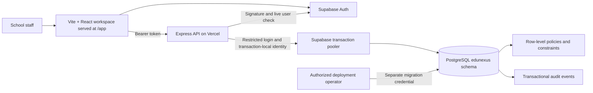
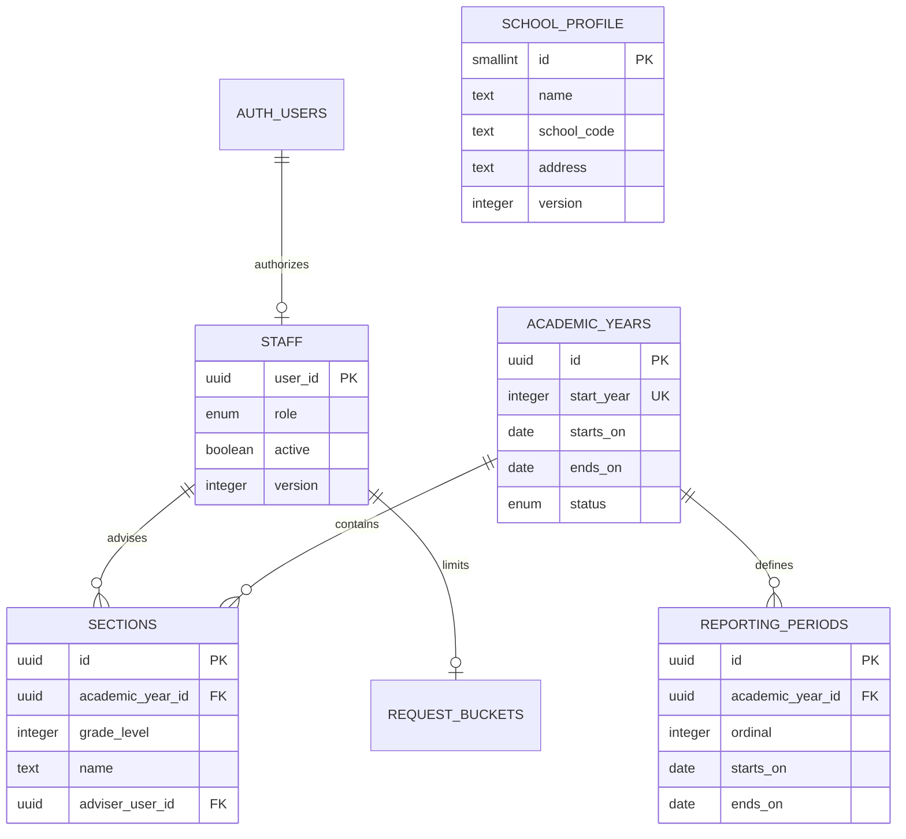

# EDUNEXUS architecture and decisions

EDUNEXUS is a modular TypeScript/Express API with PostgreSQL, Supabase Auth, and Vercel hosting. Modules share one transactional database and an explicit API contract. This fits a single elementary school's scale and allows later frontend work without changing business rules.

## Identity and authorization

Supabase manages passwords and refresh tokens. Creating a staff identity goes through an isolated Edge Function that holds the service-role key; the API runtime never does. See [staff invitations](staff-invitations.md). The API accepts ES256/RS256 access tokens issued by the configured project to the authenticated audience. It verifies signatures via the project's JWKS, checks expiry, then checks the user with the Auth service. School roles come from `edunexus.staff`, not user-editable metadata or a role claimed by the frontend. The API reads staff activation on every request.

Staff are provisioned in two stages: create a managed identity, then authorize its UUID in the staff registry. Migration 0020 adds `staff_invitations` and immutable `staff_invitation_events` around that second stage, so the intended email, name and permission level are recorded before provisioning and linked to the resulting identity afterwards. Linking creates the staff row and completes the invitation in one transaction; a `assert_may_grant_role` helper mirrors the `staff_insert` row policy, which a security-definer function would otherwise bypass. The runtime still holds no Supabase service-role key and cannot create, alter or delete an Auth identity, so an unknown identifier fails the foreign key. Recovery is initiated by the browser with the publishable key. See [staff invitations](staff-invitations.md). The bootstrap script creates the first principal and school profile only when the staff registry is empty. Only principals can manage administrative accounts; principals and administrative officers can manage teachers. This privilege split is an implementation proposal that the school can review.

Tokens are bearer credentials. The future frontend must never put tokens in URLs or logs. Signing out revokes refresh capability according to the Auth provider; an already-issued access token can remain valid until expiry. Use `staff.active=false` for immediate school-level suspension. Account recovery needs an operational process agreed with the school. [Supabase JWT documentation](https://supabase.com/docs/guides/auth/jwts).

The 0.28.1 review adds runtime shape/UUID validation to upstream identity responses and stricter deployment transport validation for the isolated account service. External outcomes remain non-transactional; reconcile an uncertain outcome before retrying. See [the review findings](backend-review-2026-09-20.md) for open score-database defects; intended privacy and concurrency guarantees must not be mistaken for verified coverage.

## Database boundary

The `edunexus` schema is private and must not be exposed through the Supabase Data API. `anon`, `authenticated`, and `PUBLIC` receive no access to its records. The Vercel API uses `edunexus_app`, a restricted login with no administrative privileges or role memberships. It does not own the tables and cannot delete records, alter schema, or modify audit events. Every business transaction verifies that it is using this restricted role.

Identity and request IDs are transaction-local PostgreSQL settings. Policies use the active staff row to enforce permissions and teacher section ownership. Fixed, empty-search-path security-definer helpers avoid recursive staff policies. The schema owner is trusted for migrations, bootstrap, and backup; RLS is enabled without forcing it on that owner. No runtime credential is allowed to be the owner. [Supabase RLS](https://supabase.com/docs/guides/database/postgres/row-level-security).

Role checks in RLS protect against missing query filters. They do not make a stolen runtime database credential harmless: the API is a trusted identity boundary and its database login can set transaction context. All user values are parameterized and the runtime secret remains server-only.

The full schema, all 44 tables across five domains, is drawn in [the entity relationship diagram](erd.md). The section below covers only the Section 1 foundation.

## Data model for Section 1

School years begin as drafts. Draft periods must be inside the year and must not overlap; activation requires consecutively numbered, chronologically ordered periods. Only one year may be active. Active years may be closed; closure is final in this section. Year-date correction and reopening require a later explicit business workflow, not a database edit from the frontend.

Sections are unique by school year, grade, and normalized name. Kindergarten is grade `0`. An adviser must be an active teacher. Open-year assignments must be reassigned before that teacher is suspended or changed to an administrative role. The model currently supports one adviser per section, and does not invent subject-teacher access: the role is unconfirmed by the school and its integration is deferred (2026-11-05), so there is no role value, no section-teacher table and no second predicate beside `may_advise_section`.

## Concurrency and audit

Section 2A adds `learners`, `enrollments`, `enrollment_events`, and `record_access_events`. The full model and effective-date conventions are in [learner registry](learner-registry.md). Annual state is unique by learner/year, references a section in the same year and grade, and changes only through restricted manager-checking database functions. Event rows preserve the state timeline. Teachers lose the relevant learner access on reassignment, withdrawal, staff suspension, or year closure; managers retain history. Successful learner/enrollment API reads append identifiers and request metadata to a protected read log without storing search terms or profile values. Managers review it by staff member (served by `record_access_actor_idx`) or by record ID; the record filter is an unindexed `= any(record_ids)` scan, acceptable at one school's volume and the first thing to index if the log grows past a few hundred thousand rows.

Updates require the previously read integer `version`. SQL includes that version in the update condition; a competing update returns HTTP 409 instead of overwriting another user's change. PostgreSQL constraints enforce uniqueness and relationships even if requests race. Adviser and staff changes share a transaction advisory lock; period changes lock their year row. Transactions have statement and lock timeouts and never include external Auth calls.

Database triggers record writes in the same transaction, with actor, request ID, changed field names, and record ID. Values, learner names, credentials, and document contents are not copied into change-audit rows. Failed/rolled-back changes do not produce successful audit events. Learner read auditing is implemented in Section 2A; document/export auditing remains future work. Logs contain the route template, method, status, duration, and generated request ID; raw URLs, bodies, and tokens are excluded. Audit cursors sort the numeric database ID even though IDs are returned as strings, preserving chronological pagination beyond single-digit IDs.

`GET /enrollment-counts` is the one learner read that writes no access row, because it returns counts by grade and status and names nobody. It is an ordinary `select … group by` under the existing enrollment row policy, so it needs no function or migration, and a teacher's count covers only what they may already read.

`edunexus.notifications` (0056) is the one table whose rows are **derived** rather than recorded, and it is shaped by that. It carries no `version` and no journal of its own: each row is emitted by a writer that has already journalled the change it reports, so a second journal would record only that a copy was delivered, and `read_at` moves `null` → timestamp once, which makes a version check a failure mode with nothing to prevent. Its row policy is recipient-only and names no manager, so it is the single table in the system where `is_manager()` grants nothing — an inbox is not a record about the school. `notify` and `notify_managers` are revoked from `public` and **never granted to `edunexus_app`**, so the API cannot insert a notification and only another security-definer writer, inside the same transaction as the change, can; `notify` returns `void` and drops an undeliverable recipient so that a notification can never fail a real school change. No notification names a learner: the `payload` check constraint admits a closed list of keys, which is what keeps a polled unread count from writing a `record_access_events` row per poll — the same reasoning as `GET /enrollment-counts` above. Full detail in [notifications](notifications.md).

Rate limiting is persistent per staff user: 180 requests per minute, shared across API instances. The counter commits independently of the business transaction. Invalid-token/anonymous abuse must be handled by provider and edge controls before it reaches this per-user limit.

## Instructional calendars

Section 3A adds `instructional_calendars` (one shared version per year), `instructional_days` (school baseline or whole-day section override), and immutable `calendar_review_events`. Partial unique indexes enforce one row per scope/date, including cleared tombstones. Composite section/year foreign keys prevent cross-year exceptions. Runtime privileges are read-only with RLS; manager-checking functions validate and commit reviewed schedules. Private effective-day resolvers are not runtime-callable.

Writers acquire the existing registry advisory lock then the academic-year row lock; readers hold a shared year lock so lazy initialization and multi-date reads are coherent. Commit rebuilds a context-bound hash and writes the root, journal, dates and audit atomically. Missing dates remain unconfigured, section sets require a base date, and school changes are blocked while configured overrides exist. See [calendar semantics](instructional-calendar.md), including daily-mark and frozen-month dependency rules.

## Daily attendance

Section 3B.1 adds `attendance_days` (section/date version), `attendance_marks` (unique annual enrollment/date, nullable AM/PM), and immutable `attendance_review_events`. Private resolvers use the corrected effective enrollment timeline; public commands enforce both section access and existing learner visibility. Teachers can record accessible assigned learners, while historical sheets and protected journals remain managerial where current access no longer applies. Reads are paginated and do not persist sheet roots.

The register takes two locks, always in this order: the academic lock `82412001`, then its section's lock `(82412002, hashtext(section_id))`. A read takes both shared. A confirmation takes the academic lock shared and its section's exclusively. Every school-wide writer takes the academic lock exclusively. So registers of different sections are read and confirmed side by side, a read never overlaps a confirmation of its own section or any school-wide writer, and two confirmations of one section still queue (migration `0023`). Reviewed 100-learner batches then take a year lock and atomically write the sheet, changed pairs and journal/audit evidence. Only active years and nonfuture configured classroom sessions accept non-null marks. Calendar triggers reject incompatible session changes. A deferred enrollment constraint trigger checks the final timeline against existing non-null marks, rejecting incompatible voids, movements and corrections at transaction completion. Clears retain history and allow a later repair. The runtime has no direct DML on these tables. See [daily attendance](daily-attendance.md) for teacher scope, hash semantics and the monthly freeze integration.

## Monthly attendance

Section 3B.2 adds `attendance_months` (section/month version and state), immutable `attendance_month_snapshots` (complete dated membership, marks and calendar/context) and `attendance_month_events` (reviewed transition evidence referencing snapshots). Manager-only RLS and validated commands protect history. Teachers receive assigned-section status through a restricted function without member/count disclosure. Live monthly reviews materialize corrected timelines once and fail above 1,000 members; member responses page at 100.

Submission, return, locking and reopening use the registry advisory lock and shared year lock. Snapshots/root/events/audits are atomic. Submitted and locked months reject daily/calendar mutations; a deferred enrollment trigger compares final membership against frozen dates, including no-class days without marks. Identity changes involving frozen members are blocked; profile/adviser edits leave frozen evidence intact. Daily context now binds month state/version. See [monthly attendance](monthly-attendance.md) for correction order, history, closed-year limits and rollback compatibility.

## Classroom absence monitoring

Section 3B.3 adds the read-only `read_attendance_monitor` function, access-log resource and API module. The function validates assigned-section/current-learner scope, date and page bounds, uses the existing registry/year locks, materializes effective timelines and date cells, filters before pagination, and returns only bounded evidence. The API deterministically derives classifications and raw session/date-run counts. No domain tables or background jobs are added. Monitoring stays live; frozen monthly submissions remain separate immutable evidence. See [monitor semantics](attendance-monitor.md).

## Manual attendance follow-up

Section 3B.4 adds `attendance_followups` and immutable `attendance_followup_events`. A partial unique index permits one open case per annual enrollment; composite FKs preserve enrollment/section year scope. Manager-only RLS and SELECT-only runtime grants protect reasons and snapshots. Validated commands own opening and lifecycle mutations, bind actor/owner/source versions into review hashes, and atomically write cases, events and audits under existing locks.

The monitoring query now lives in a private helper with an optional exact enrollment parameter; the public monitor wrapper preserves its existing behavior. Cases store versioned opening evidence and compare it to fresh scoped evidence. Source corrections do not rewrite history or block case resolution, and case work remains independent of monthly locks/year closure. No policy thresholds, automation or messages are enabled. See [follow-up semantics](attendance-followups.md).

## Academic setup

Sections 4A.1 and 4A.2 add catalog subjects and section offerings with immutable before/after journals. Subject codes are immutable; names, kinds and applicable grades are explicit versioned metadata. Offerings retain the selected catalog snapshot and use composite section/year references, FK indexes and per-section subject uniqueness. Catalog edits never rewrite pinned selections. Only draft years permit explicit refresh; closed years block offering changes.

Validated commands share the registry advisory lock and acquire the school-year lock before offering writes. Runtime tables have SELECT-only grants and RLS; private helpers are not executable by the runtime role. Managers write and read history; teachers read the catalog and their current advised open-year offerings. No learner permissions, assessment policies or formulas are added. See [catalog](subject-catalog.md) and [offerings](section-subjects.md).

Section 4A.3 adds manager-only weighted-assessment drafts and immutable revision journals. Canonical component JSON uses distinct codes and integer basis points totaling 10000; grade applicability excludes Kindergarten. SQL validation is private, runtime DML is denied and versioned writes atomically journal changes. Drafts have no approval state or relationship to offerings, scores or calculations. Source references are inert supplied text. See [assessment-policy drafts](assessment-policy-drafts.md).

Section 4A.4 adds `assessment_policy_adoptions` and immutable `assessment_policy_adoption_events`. An adoption copies the whole draft revision into a frozen `policy_snapshot`, so later draft edits advance the draft's own history without changing what the school decided. A partial unique index permits one standing adoption per school year and policy while withdrawn rows remain as evidence. The manager-checking writer takes the shared academic setup lock, locks the target year for share, validates the year status, in-year adoption date and current unarchived draft version, then atomically writes the row, journal and audits. Migration 0018 also replaces the 4A.3 draft writer so archiving an adopted draft is refused; migration 0017 stays unchanged. Adoption binds no offering, accepts no score and computes nothing. See [assessment-policy adoption](assessment-policy-adoptions.md).

Section 4A.5 adds `assessment_policy_bindings` and immutable `assessment_policy_binding_events`, scoping a standing adoption to one section subject offering. A composite section/year foreign key and an explicit year, grade and active-offering check keep a binding inside the adoption's school year and applicable grades. A partial unique index permits one standing binding per offering while released rows remain as evidence. Migration 0019 also replaces the 4A.4 adoption writer and the 4A.2 offering writer so a standing binding blocks withdrawing its adoption or retiring its offering; migrations 0016 through 0018 stay unchanged. Binding computes nothing and expands no teacher permission. See [assessment-policy binding](assessment-policy-bindings.md).

Section 4B.1 adds `assessment_tasks`, `assessment_scores` and immutable task and score journals. A task draws its component code from the bound adoption's frozen snapshot, so component names are never invented, and an offering without a standing binding cannot hold assessments. Scores carry per-row versions, so concurrent entry for different learners in one task does not conflict, and an unrecorded learner has no row and reads as null rather than zero. Batches of up to 100 commit atomically and write one journal row holding before/after per changed entry, the shape daily attendance uses. Advisers read and record for their own current open-year sections under RLS while managers retain historical access; both journals are manager-only. `assessment_entry_context` resolves offering, binding and access in one private helper. No total, weighting, percentage, rounding, transmutation or grade is computed. Migration `0022` corrects four defects found reviewing that work: the score policy and writer re-check `can_read_enrollment`, so a former adviser loses a departed learner's marks in SQL as well as HTTP; an omitted `raw_score` key is refused, so only an explicit null clears a mark; score sheet, entry and history reads append to `record_access_events` like every other learner read; and both score columns widened to `numeric(7,2)` so the documented maximum fits. Migration `0024` adds `read_assessment_components`, the one read an adviser has into the policy chain: the bound revision's component codes and names, never weights, under the same access rule as entry and with the academic lock taken shared. See [assessment tasks and raw scores](assessment-scores.md).

Section 5 — promotion — gained three rules in migration `0069` (0.103.0), each of them a place where the system had been trusting a person to remember something.

**A reporting period now has a window.** `reporting_periods` carries dates and no status, and the four report-card writers checked only that a period belonged to the year. The window is enforced by `guard_report_period()`, a `before insert or update` trigger on `report_grades`, `report_values` and `report_notes`: a period whose `starts_on` is after today in Manila is refused with `P1908`. It is on the tables rather than inside the writers so that all four — including `record_report_card`, which writes one learner’s whole card in a single transaction — and any writer added later obey one rule. A period already begun never closes, because the ECR’s figures arrive after a term is over; a record naming no period (the subject average, the general average, the SF2 month remark) is outside the window by design.

**Promotion has a readiness gate.** `read_promotion_readiness(uuid)` counts the records that grade’s card prints against the section’s currently enrolled learners, deriving the requirement from `promotion_requirement(smallint,integer)` — which encodes DO 15, s. 2026, Table 12 the same way `web/deped.ts` does, so Kindergarten requires nothing and a descriptively graded grade requires its term narratives instead of numeric grades. Both promotion writers call `assert_promotion_ready` and refuse with `P2002`. The read takes the academic lock shared, reads no grade value, names no learner and writes no `record_access_events` row, mirroring `read_grade_entry` (0035) exactly.

**An approved outcome enrols the learner into the next school year.** `decide_promotions` calls `advance_approved_enrollment(uuid)` for each learner it approves, in the same transaction: the next grade for `promoted` or `conditionally_promoted`, the same grade for `retained`, no section, through `place_enrollment` — the one writer every enrolment goes through. It returns a reason rather than raising when it cannot advance (`remedial`, `completer`, `no_next_year`, `already_enrolled`, `not_enrolled`, `no_lrn`), so the school’s decision stands whether or not next year exists to receive it, and one learner with no LRN cannot take a class’s approval down. Because EDUNEXUS may not invent a school year, `carry_forward_on_new_year()` — an `after insert` trigger on `academic_years` — runs the outstanding carry-forward the moment the following year is created. Duplication is impossible rather than merely avoided: `enrollments_valid_learner_year_idx` (0008) is the constraint, and the advance checks for an existing enrolment first. Lock order is unchanged: `decide_promotions` takes `82412001` exclusively before `promotion_section` reads the source year `for share`, and `place_enrollment` then locks the **target** year row. Runs are recorded in `next_year_placements` beside the manual ones, in chunks of 500. See [the promotion gate](promotion-gate.md).

Section 6 -- the official forms -- gained one read in migration `0070` (0.104.0), and the reason it was needed is worth more than the read. **An SF9 is derived per enrollment and never stored**: `read_sf9_source` takes an enrollment id, every report-card record is keyed by `enrollment_id`, and `form_issuances` carries a CHECK that an `sf9` row names both an `academic_year_id` and an `enrollment_id`. The prior that `record_form_issuance` looks for before writing is keyed on that same scope, so a later grade’s issuance is a new row with `supersedes_id` null and cannot find, supersede or overwrite an earlier grade’s; no row in that table is ever updated or deleted. So an issued card is preserved and a promoted learner’s next card is blank without either being a feature -- both follow from the key.

What could not be answered was *which* of a learner’s years had an issued card: an `sf9` row has `learner_id` NULL by that CHECK, so `formIssuanceList`’s `learner_id` filter matches none, and `form_issuances`’ row policy (`is_manager() or actor_user_id=actor_id()`) shows a teacher only the forms they issued. `read_sf9_history(uuid)` answers it: one row per enrollment, joined **outward** to `sections` so a learner with no class yet still appears, with every row decided by `can_read_enrollment` so no read scope widens. It is `security definer` and so bypasses that row policy deliberately and narrowly -- it discloses the serial and fingerprint printed on the card the caller may already print, and **no staff name or id at all**, which keeps the 0.92.0 boundary rather than widening it for a form. It reads no grade, and it writes a `record_access_events` row under the new resource `sf9History`. See [the SF9 history](sf9-history.md).

## Hosting and connections

Section 2B.2 adds append-only `enrollment_corrections` and FK-backed `enrollment_correction_sections`. A private resolver combines the latest corrected sequence with subsequent ordinary movements. Manager-only functions expose a consistent effective timeline, validate previews, compare a hash of the proposal/context, and atomically snapshot corrections with a projection update. Original movement events are never rewritten; only a transaction-bound correction intent suppresses a fictional movement on projection repair. Original-history responses are explicitly labeled. See [timeline semantics](enrollment-timeline.md) before implementing attendance or reports. Snapshot history is paginated at at most ten revisions per response; only two timeline POST routes raise the JSON body limit from 32 to 256 KiB.

Section 2B.1 adds `import_previews` and `lrn_corrections`. Pending previews hold input/plan hashes and review metadata. The API rebuilds the plan under the shared roster lock, then creates all rows and a retry receipt in one transaction. A statement-level learner trigger takes that lock before learner row locks, preventing a concurrent insert from evading duplicate revalidation. A year row lock prevents closure during commit. LRN changes require an immutable next-version intent in the same transaction. Direct runtime writes to both new tables are revoked; manager-checking functions and RLS enforce preview ownership and protect correction history. See [registry review](registry-review.md).

Vercel supports an exported Express entry point. The project targets Node 24 and Singapore (`sin1`). PostgreSQL connections use the transaction pooler, certificate-verified TLS, prepared statements disabled, a small local pool, and Vercel's pool lifecycle integration. No request writes files to local disk. Date-only database fields remain `YYYY-MM-DD`; timestamps are serialized as UTC ISO strings. [Express on Vercel](https://vercel.com/docs/frameworks/backend/express), [Node versions](https://vercel.com/docs/functions/runtimes/node-js/node-js-versions), [Supabase connection pooling](https://supabase.com/docs/guides/database/connecting-to-postgres).

SQL migrations have ordered names and checksums. The operator runner serializes migration work with an advisory lock and commits all pending changes transactionally. It refuses a modified already-applied migration. Add a new migration for every deployed schema change. CI tests and builds code; it deliberately does not receive privileged production database credentials or run migrations during Vercel builds.

Section 2B.3 adds nullable learner identity pointers, identity revisions, and immutable `learner_identity_events`. Manager-only functions revalidate a database-generated review hash under the shared registry/year/learner locks, create a transaction-bound event, and update both profile versions. Original enrollment ownership is immutable. A restricted resolver supplies retained IDs to API enrollment projections, while teacher enrollment RLS remains unchanged. Linked profiles are read-only; annual uniqueness and birth-date guards cover the identity group. Imports resolve linked candidates and timeline hashes use the retained profile. See [identity semantics and rollback compatibility](learner-identity.md).

Section 2B.4 adds enrollment `record_state` and immutable `enrollment_record_events`. Reviewed void/restoration advances enrollment versions without fabricating movement events. A partial unique index covers valid original learner/year records, while the shared-lock identity guard also enforces group-wide annual uniqueness. Teacher RLS, list defaults, import occupancy, identity conflict/date checks, and timeline eligibility honor validity. Protected snapshots bind both duplicate/retained record contexts and preserve history. Closed years and conflicting restorations remain blocked. See [record review and rollback compatibility](enrollment-records.md).

Section 2B.5 extends the existing correction journal with revision kind and nullable old/new grade metadata. Timeline and grade-placement wrappers call one private validator/writer so version/hash, date/transition, section-reference, and rollback rules stay consistent. Placement requires a different Kindergarten–Grade 6 target and preserves the non-section content of every effective entry. A transaction-bound grade-change guard rejects unreviewed changes; original school year remains immutable. The effective resolver requires no separate history merge because both correction kinds use the same version sequence. See [placement semantics](grade-placement.md), including downstream finalization dependencies.

Migration 0053 adds one column, `edunexus.learners.address`, and the two grants that make it writable. It is worth a line here for the grant rather than for the column: 0004 grants `insert` and `update` on that table **column by column**, so `version`, `created_at`, `updated_at`, `merged_into` and `identity_revision` are not writable by the API at all — they belong to the triggers and to the reviewed identity workflow. A new column therefore has no grant and is refused with *permission denied for column …*, surfacing as a 403 that reads like a role problem. Any future column on `learners` needs exactly `grant insert(col),update(col)`, never a blanket grant on the table. Migration 0056 is the second instance and followed exactly that: `guardian_name` and `guardian_contact`, one `grant insert(col),update(col)` each, and `tests/registry-guardian.test.ts` reads `information_schema.column_privileges` to assert both grants exist rather than trusting that the registration happened to work. 0056 also had to **`create or replace` `register_learner_into_section`**, which 0054 wrote with a closed *deny-unknown* allow-list of profile keys: a new learner column is rejected by that list with `Invalid learner fields` the moment the contract carries it, which is the control working, and the replacement is a new migration rather than an edit to 0054, as 0018, 0019 and 0021 each did. The column itself needs nothing else: the `version_record` and `audit_record` triggers, the manager-only insert and update policies and the `can_read_learner` read policy all come from 0004, and the learner writers are ordinary statements in `src/modules/registry/service.ts` under those policies rather than security definer functions. The field is one nullable line and is the only learner field beyond the name, LRN, birth date and sex; what else may be held is behind the learner-fields gate in [constraints.md](constraints.md).
