# Entity relationship diagram

Originally generated from the live `edunexus` schema through 21 migrations. On 28 September 2026, a clean local rebuild through migration 0024 still contained 44 tables. The [paper-ready Figures 7-9](diagrams/paper/README.md) are the current, schema-verified process views, with corrected optionality and historical cardinalities. The Mermaid diagrams below and their older renders are retained as earlier reference material; use the paper guide's constraint notes where they differ. A single diagram at this size is unreadable, so this document provides a general view in two parts, followed by domain and process views.

For a document rather than a screen, use the rendered figures in [diagrams/](diagrams/): each diagram as SVG and as a double-resolution PNG, with suggested captions.

## General view

The whole system in two figures, showing only the entities that hold current state. They omit the 14 change journals, the two audit logs and the rate limiter, which together account for most of the table count and none of the meaning. Those appear in the domain diagrams below.

The cut is along the seam the school already works to: what is recorded about a learner day to day, and what is recorded about their academic work. Each part repeats the entities it needs, so each stands on its own, the same way the process views do. Between them they carry all 20 entities and all 24 relationships.

One figure for all twenty comes out almost square, at 2188 x 1881, because the entity boxes are wider than they are tall and six of them are roots with no parent. Mermaid's ER renderer offers no way to change that: `layoutDirection`, `nodeSpacing`, `rankSpacing` and `minEntityWidth` are all accepted and then ignored, a `direction LR` statement makes it wider still, and dropping the attribute blocks makes it wider again. A near-square figure has to be shrunk to illegibility to fit a portrait page, which is why this is two.

### Records

School, staff, the school year and its sections; learners and their annual enrollment; the instructional calendar and everything recorded against it.

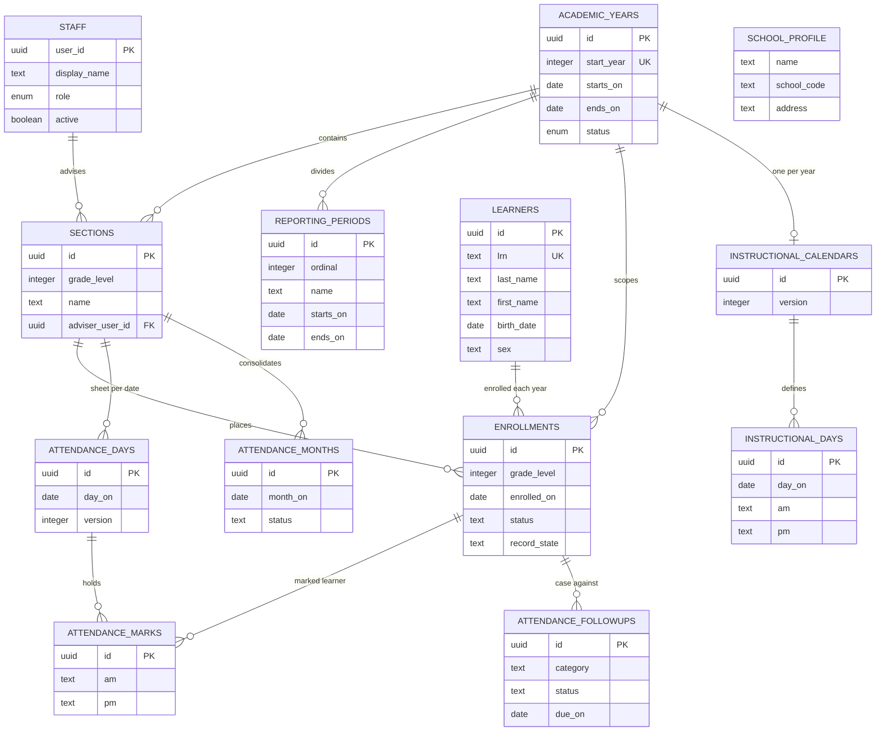

### Academics

The subject catalog and section offerings, the assessment policy chain from draft to binding, and the tasks and raw marks recorded against an annual enrollment.

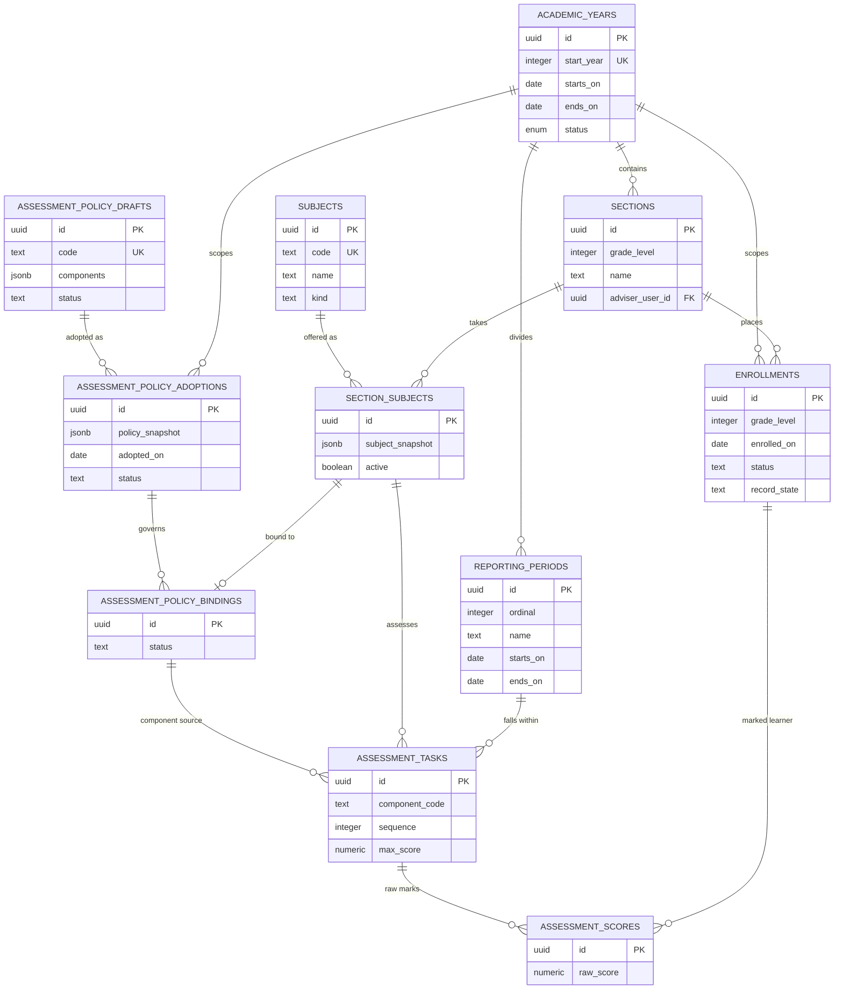

Read left to right and it is the school year: a year holds sections and reporting periods, a learner is enrolled into a section for that year, attendance is marked against that enrollment, and scores are recorded against it too. Everything downstream hangs off the annual enrollment rather than off the learner, which is what lets one child carry six years of records without their history being rewritten each August.

## How to read these

Two patterns repeat throughout and explain most of the table count.

**Every record that can change has a journal beside it.** A table named `x` usually has a partner named `x_events` holding an immutable before/after snapshot of each change, with the actor, a reason, and the request ID. The journals are written in the same transaction as the change: if the journal cannot be written, the change rolls back. They are shown in the diagrams because they are half the schema, but they always hang off their parent in the same way.

**Every changeable record carries a `version`.** A write supplies the version it last read, and the database refuses the write if that no longer matches. This is what stops two staff overwriting each other silently.

Three tables are global and left out of the domain diagrams to keep them legible:

- `audit_events` — append-only change audit for every table. Records actor, request ID, table, row and the names of changed fields. Never values, learner names or credentials.
- `record_access_events` — append-only log of successful learner and enrollment reads. Records who read which record IDs, never search terms or profile values.
- `request_buckets` — persistent per-staff rate limiting.

Every `*_events` table also references `staff` as the actor. Those edges are omitted from the diagrams; assume them everywhere.

## Overview

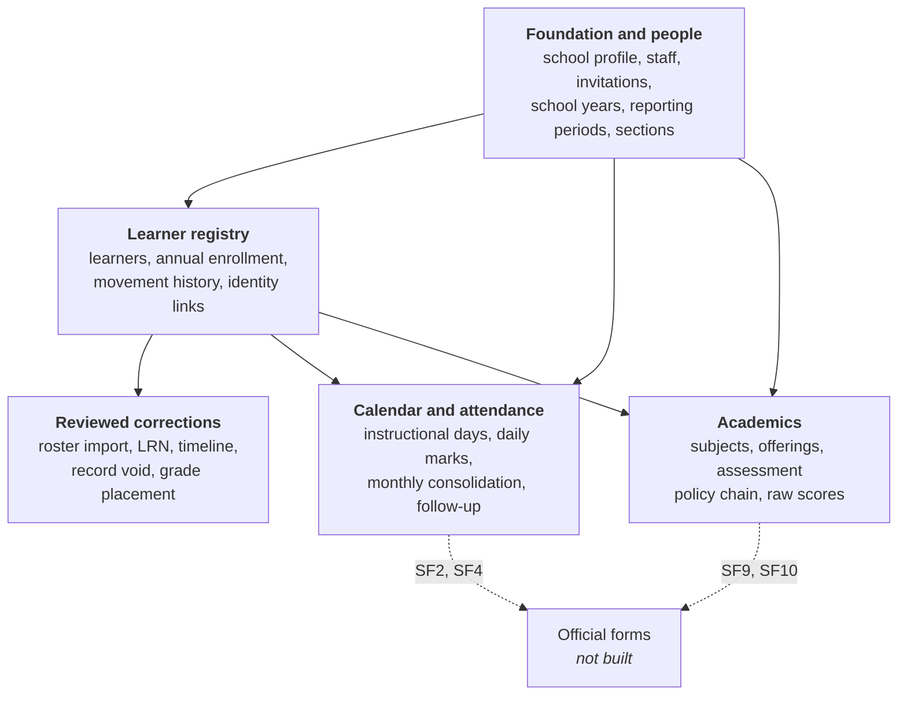

Foundation defines the school year, its sections and who may act. The registry places learners into those sections. Attendance and academics both record against an annual enrollment. Corrections sit beside the registry rather than inside it, because a correction never rewrites the original record.

## Foundation and people

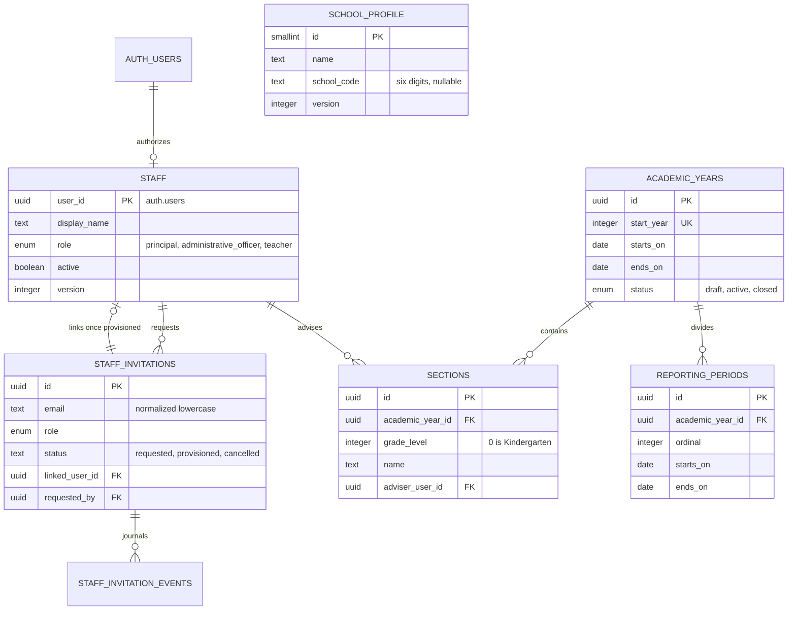

Sections are unique by year, grade and normalized name. An adviser must be an active teacher. A composite key of `(id, academic_year_id, grade_level)` lets later tables reference a section and inherit its year and grade, which is how cross-year mistakes are made impossible rather than merely checked.

## Learner registry and enrollment

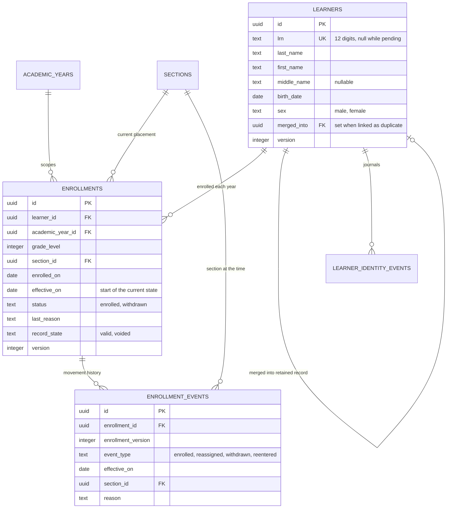

One learner record persists across school years; the annual enrollment sits underneath it. A partial unique index enforces one **valid** enrollment per learner per year, so a voided record stays as evidence without occupying the slot. `effective_on` is the first day of the new state, not the last day of the old one.

## Reviewed corrections

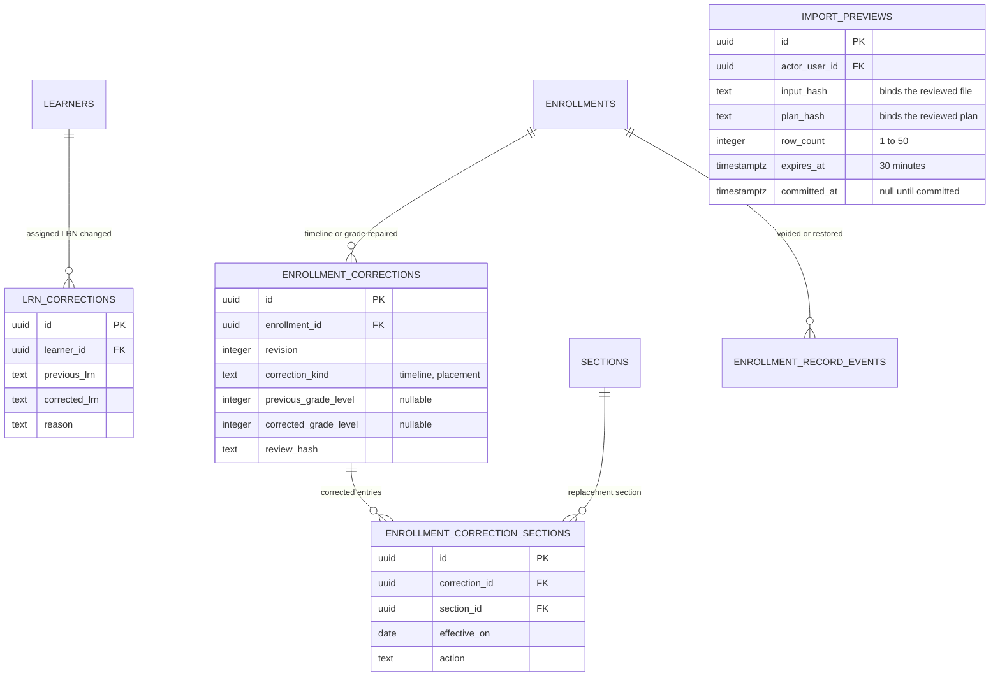

Corrections are additive. The original `enrollment_events` rows are never rewritten; the effective timeline is the latest correction snapshot plus any ordinary movements recorded after it. Import and correction commits bind a hash of exactly what was reviewed, so a changed file or a stale preview is refused rather than silently applied.

## Calendar and attendance

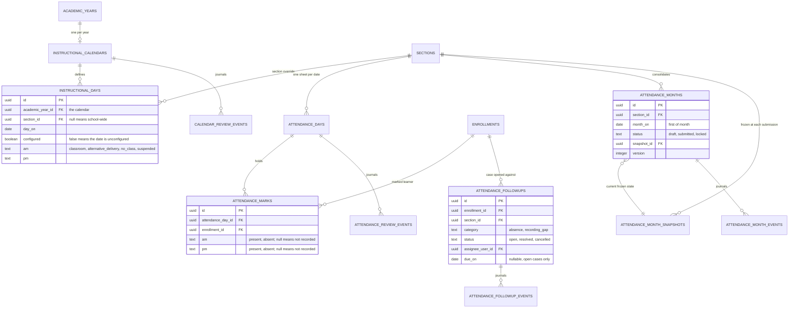

A date with no calendar row is **unconfigured**, not a school day, and a session with no mark is **unknown**, not present. Both are deliberate: inferring either would corrupt an SF2. Submitting a month freezes an immutable snapshot of who was enrolled and what was marked, and a deferred constraint trigger blocks any later edit that would contradict a frozen month.

## Academics

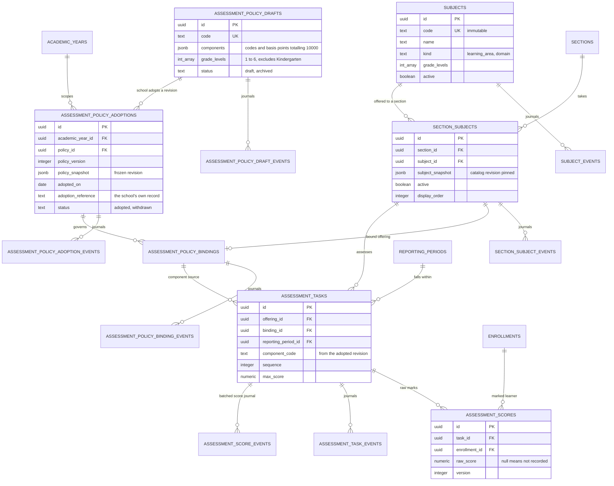

The chain runs draft → adoption → binding → task → score, and each link protects the one below it: an adopted draft cannot be archived, a bound adoption cannot be withdrawn, and a bound offering cannot be retired, until the thing depending on it is released first. An adoption freezes the whole draft revision, so revising the draft afterwards never changes what the school decided.

**Nothing in this domain computes a grade.** There is no table, column or endpoint for a total, average, percentage, MPS, GWA or transmuted mark. Those wait on the school's grading enclosure, recorded as a gate in [constraints](constraints.md).

## Process views

The five domain diagrams above are cut by how the system is built, and are meant to be read in order: each assumes the one before it. The three below are cut by the school processes the manuscript names, and each one is **standalone** — it repeats the upstream entities it depends on, so a single figure can carry a section of a document without the others beside it.

Same schema and the same tables, sliced a second way. These are not separate databases, and an entity appearing in two views is one table.

### Class preparation

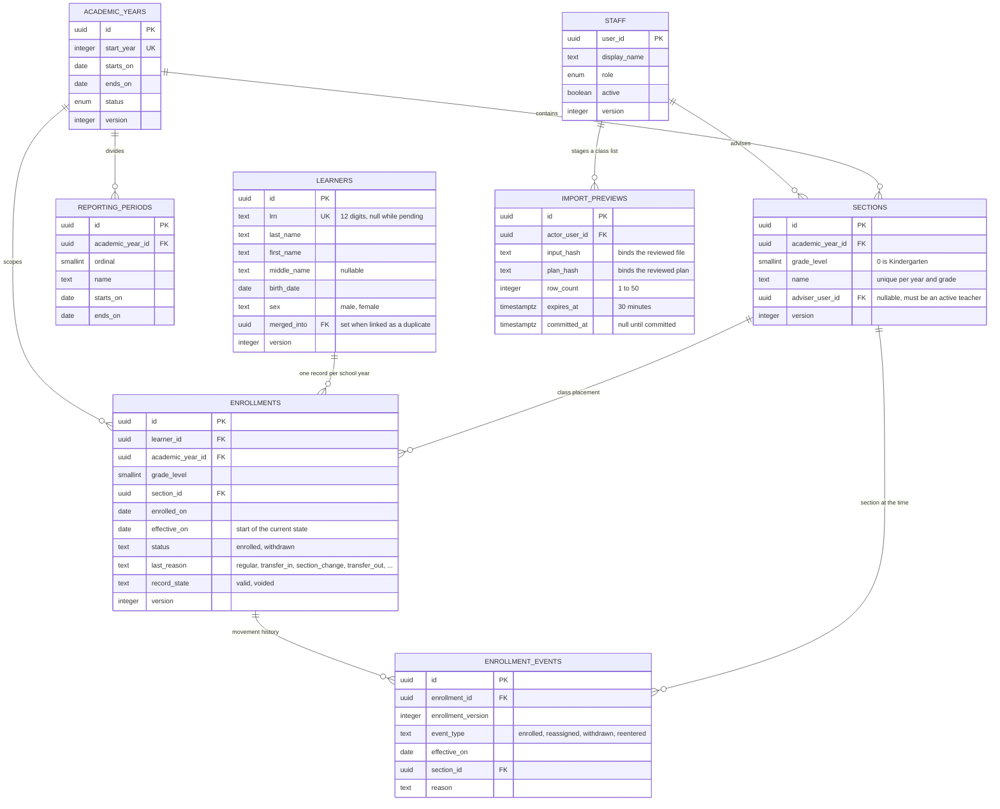

Preparing classes is one pass per school year: open the year, divide it into reporting periods, create its sections, give each an adviser, then place learners.

A section is unique by year, grade and normalized name, and it carries a second key of `(id, academic_year_id, grade_level)`. Every table that references a section references that composite key, which is why a learner cannot be placed into a section belonging to another year or another grade — it is impossible rather than merely checked. An adviser must be an active teacher, and may be null while the section is still being set up.

One **valid** enrollment per learner per school year is enforced by a partial unique index, so a voided record stays as evidence without occupying the slot. The learner record itself persists across years; only the enrollment underneath it is annual, which is what lets a child carry six years of history without any year being rewritten.

A class list imported from a file is staged as a preview first. The preview stores a hash of the exact file and of the plan that was reviewed, and the commit must present both, so an edited file or an expired preview is refused instead of being applied quietly.

### Attendance record

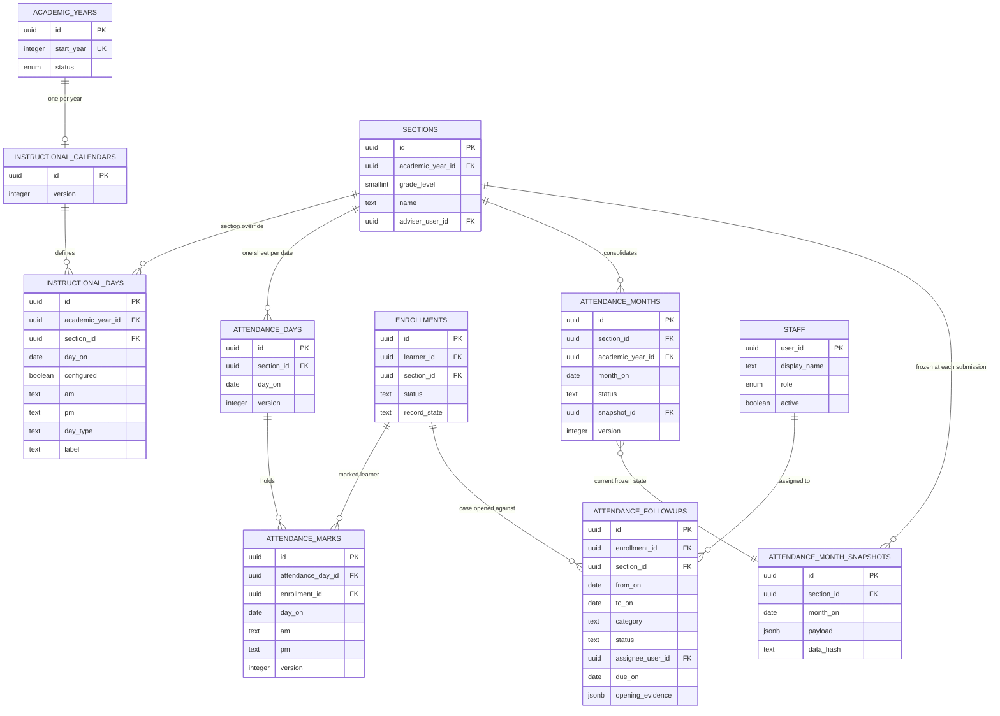

The figure carries no note column, so the values it leaves out are here. An instructional day records `am` and `pm` as one of `classroom`, `alternative_delivery`, `no_class` or `suspended`, and a `day_type` of `regular`, `holiday`, `school_break`, `weekend`, `makeup`, `suspension` or `other`; `configured` is false exactly when the date has never been described. A day row with a null `section_id` is school-wide, and one with a section is that section's override. A mark records `am` and `pm` as `present` or `absent`, with null meaning not recorded. A month is `draft`, `submitted` or `locked`, keyed to the first of the month. A follow-up case has a `category` of `absence` or `recording_gap`, a `status` of `open`, `resolved` or `cancelled`, a due date only while open, and a window of at most 31 dates.

Two absences of a record are meaningful here, and neither is a zero.

A date with no configured calendar row is **unconfigured** — it is not a school day, and it is not a non-school day either; nothing is known about it. A session with no mark is **unknown**, not a presence and not an absence. Inferring either would put an invented figure on an SF2, so both stay null and the workflows refuse to proceed until a human resolves them.

Marks attach to the annual enrollment rather than to the learner, so a child who changes section mid-year keeps one continuous attendance history and the old section's records stay as they were recorded. `day_on` is duplicated onto the mark to carry the unique constraint that stops the same enrollment being marked twice for one date.

Submitting a month writes an immutable snapshot of exactly who was enrolled and what was marked, and the month row points at the current one. Resubmitting writes a new snapshot rather than editing the old one, so every submission the school made remains reconstructable. A deferred constraint trigger blocks any later edit to attendance, calendar or roster that would contradict a frozen month.

Counts produced here are **raw session counts**, not official attendance credits. The conversion to SF2 and SF4 arithmetic waits on the school's approved mark meanings and half-day rules.

### Academic record

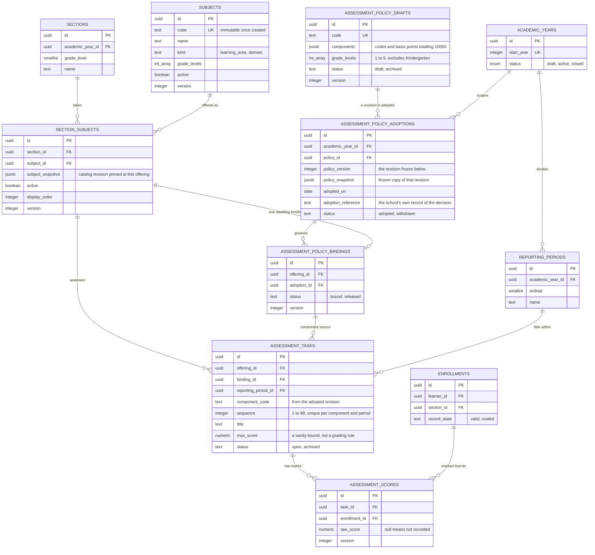

The chain runs draft → adoption → binding → task → score, and each link protects the one below it. An adopted draft cannot be archived, a bound adoption cannot be withdrawn, and a bound offering cannot be retired, until whatever depends on it is released first.

Two snapshots do the real work. A section offering pins the subject catalogue revision it was created from, so renaming a subject later never rewrites what a past section was taught. An adoption freezes the entire policy revision it was made from, so revising the draft afterwards never changes what the school actually decided. `adoption_reference` is the school's own record of that decision; it is not treated as evidence that the content is correct.

**Nothing in this view computes a grade.** There is no table, column or endpoint for a total, average, percentage, MPS, GWA or transmuted mark, and `raw_score` left null means a mark was never recorded, never a zero. Those calculations wait on the school's current DepEd grading enclosure and its own ECR examples, recorded as a gate in [constraints](constraints.md). Until that gate opens, this view stores what a teacher wrote down and nothing derived from it.

## What is not here yet

The schema has no tables for promotion and next-year assignment (Section 5) or for released official forms and their signatories (Section 6). Both are blocked on school decisions rather than on design. When they arrive, promotion will reference `enrollments` across two school years, and released forms will hold immutable snapshots rather than regenerating from live records, for the same reason monthly attendance already does.
